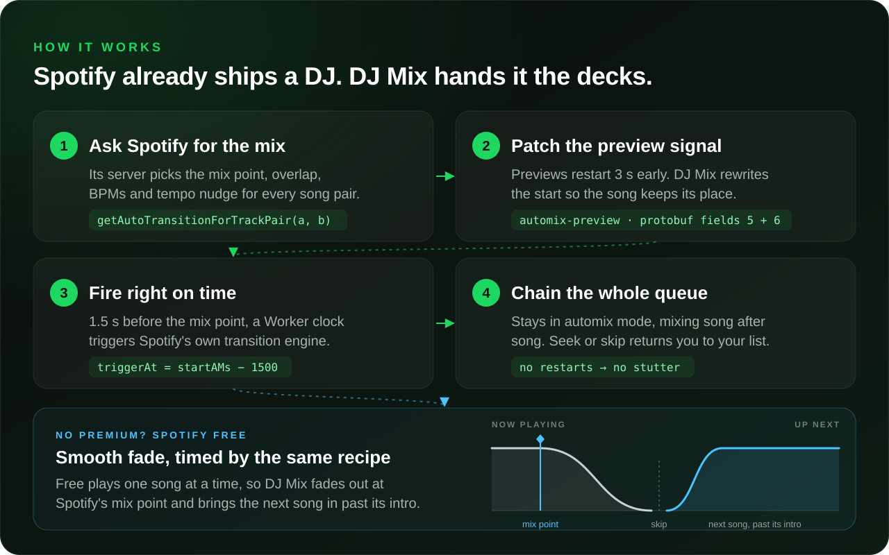

<p align="center">
  
</p>

<p align="center">
  <a href="#install"></a>
  <a href="https://github.com/ranveerthapar025-bit/spicetify-DJ-MOD-automix/releases/latest"></a>
  
  <a href="#spotify-free-accounts"></a>
  
  <a href="LICENSE"></a>
</p>

<h3 align="center">Your playlists, mixed like a DJ set.</h3>

<p align="center">
  The Spotify desktop app has a beat-matching transition engine hidden inside it.<br>
  <b>DJ Mix</b> switches it on for every song you play: the next track slides in on the beat,<br>
  its tempo locks to the one that's playing, and the two blend like a real DJ mix. No dead air. No hard cuts.<br>
  <sub>On Spotify Free, where that engine won't play, DJ Mix uses a <b>Smooth fade</b> timed by the same engine's mix points.</sub>
</p>

<p align="center">
  <a href="#install"><b>Install</b></a> &nbsp;·&nbsp;
  <a href="#using-it"><b>Using it</b></a> &nbsp;·&nbsp;
  <a href="#how-it-works"><b>How it works</b></a> &nbsp;·&nbsp;
  <a href="#troubleshooting"><b>Troubleshooting</b></a>
</p>

> [!TIP]
> **New in v0.5.0:** DJ Mix now works on **Spotify Free**. It switches to a **Smooth fade** at Spotify's mix point when beat-matching isn't available. Queued songs and pairs with no transition fade instead of cutting, and your volume is always put back. [Release notes →](https://github.com/ranveerthapar025-bit/spicetify-DJ-MOD-automix/releases/tag/v0.5.0)

## Crossfade vs DJ Mix

|  | Spotify crossfade | **DJ Mix** |
| :-- | :-- | :-- |
| **When the next song starts** | A fixed number of seconds before the end, for every song | At the mix point Spotify's engine picks for that exact pair of songs |
| **Beats** | Two songs on top of each other, usually off-beat | Lined up bar for bar whenever the engine can beat-match the pair |
| **Tempo** | Untouched | The incoming song is sped up or slowed down a touch to lock in |
| **What you hear** | One song fading out while another fades in | An overlap that sounds like a DJ blend |
| **On Spotify Free** | The same fixed-length fade | ✅ A smooth fade at Spotify's mix point, with the next song starting past its quiet intro (see [Free accounts](#spotify-free-accounts)) |

## Features

- 🎚️ **Beat-matched overlaps** — every transition comes from Spotify's own automix engine, the one built for its playlist Mix feature.
- 🥁 **Tempo sync** — the incoming song is nudged by a percent or two so the beats stay locked through the blend.
- 🆓 **Works on Spotify Free** — Spotify only plays its beat-match engine on Premium. On Free, DJ Mix detects that and switches to a **Smooth fade** timed by the same engine's mix points.
- 🛟 **No more hard cuts** — songs beat-match can't mix (queued songs, pairs Spotify has no transition for) get a smooth fade instead of an abrupt change.
- 🔗 **Seamless chaining** — once the first mix fires, DJ Mix keeps mixing song after song without restarting playback, so there's no stutter between mixes.
- ⏭️ **Your controls still work** — seek, skip and back all work mid-mix and drop you back into your playlist at the right spot.
- 🪟 **Works when minimised** — timing runs on a background Worker clock, so mixes land on time even with Spotify in the tray.
- 📍 **See the mix coming** — a glowing zone on Spotify's seek bar shows exactly where the next blend lands and how long it lasts, with a live countdown in the panel.
- ⏩ **Mix now** — jump straight to the next blend instead of waiting for the end of the song.
- 🙅 **Skip this mix** — let one song end normally, just this once (and undo it if you change your mind).
- 🎛️ **Mix filters** — only mix when Spotify can beat-match, and/or cap how much the tempo is allowed to change.
- 📜 **Mix history and stats** — your last mixes with BPMs and tempo change, plus all-time totals: mixes, % beat-matched, average tempo shift, minutes of blending.
- ⌨️ **Ctrl+Alt+D** — toggle DJ Mix from anywhere in Spotify.
- 🔊 **Volume-safe fades** — touch the volume slider mid-fade and DJ Mix backs off; seek, skip or even a crash puts your volume back.
- 🔔 **Mix notifications** — `🎧 Mixing into <song> · beat-matched (+1.6% tempo)` or `🎚️ Fading into <song>`, if you want them.
- 🪶 **One file** — a single JavaScript file. No servers, no accounts, nothing talks to anything except Spotify.

## Install

**You need**

1. The **Spotify desktop app** from [spotify.com/download](https://www.spotify.com/download). The Microsoft Store version doesn't work with Spicetify.
2. **[Spicetify](https://spicetify.app/docs/getting-started)** installed and applied at least once.

### Easiest — Spicetify Marketplace

Open **Marketplace** in Spotify's sidebar, go to **Extensions**, search **DJ Mix** and click **Install**. Done.

<sub>No Marketplace yet? See the <a href="https://spicetify.app/docs/customization/marketplace">Spicetify Marketplace docs</a>, or use the one-paste install below.</sub>

### Quick install — Windows

Paste this into PowerShell:

```powershell
$dir = "$env:APPDATA\spicetify\Extensions"
New-Item -ItemType Directory -Force $dir | Out-Null
Invoke-WebRequest "https://github.com/ranveerthapar025-bit/spicetify-DJ-MOD-automix/releases/latest/download/djmix.js" -OutFile "$dir\djmix.js"
spicetify config extensions djmix.js
spicetify apply
```

Spotify restarts with DJ Mix running. That's it.

<details>
<summary><b>macOS / Linux</b> (untested so far)</summary>

<br>

```bash
mkdir -p ~/.config/spicetify/Extensions
curl -fsSL https://github.com/ranveerthapar025-bit/spicetify-DJ-MOD-automix/releases/latest/download/djmix.js \
  -o ~/.config/spicetify/Extensions/djmix.js
spicetify config extensions djmix.js
spicetify apply
```

Nothing in the code is Windows-specific, but it has only been tested on Windows. If your Spotify build lacks the beat-match engine, DJ Mix falls back to Smooth fade instead of breaking anything.

</details>

<details>
<summary><b>From a clone</b> (for hacking on it)</summary>

<br>

```powershell
git clone https://github.com/ranveerthapar025-bit/spicetify-DJ-MOD-automix.git
cd spicetify-DJ-MOD-automix
powershell -ExecutionPolicy Bypass -File .\deploy.ps1
```

`deploy.ps1` copies `djmix.js` into Spicetify's Extensions folder, enables it if it isn't already, and runs `spicetify apply`. It finds the Spicetify CLI even in a terminal opened before Spicetify was installed. Run it again after every edit.

</details>

### Updating

- **Marketplace:** update DJ Mix from Marketplace's Extensions tab.
- **Quick install:** run the `Invoke-WebRequest` line again (or the `curl` line on macOS/Linux), then `spicetify apply`. It always fetches the latest release.

### Uninstall

```powershell
spicetify config extensions djmix.js-
spicetify apply
```

## Using it

Play any playlist or album and let it run. A glowing zone appears on Spotify's seek bar where the next mix will land: **green** for a beat-matched mix, **blue** for a smooth fade. When the song reaches it, the next song blends in.

Click the **DJ Mix button** in the playbar to open the panel. It shows the next mix live: when it lands, a countdown, how long the overlap or fade is, both BPMs and the tempo change, plus which engine is running and why.

<p align="center">
  
</p>
<p align="center"><sub>Illustration. Song name and numbers are examples.</sub></p>

| Setting | Default | What it does |
| :-- | :-- | :-- |
| **Mix songs like a DJ** | On | Turns mixing on or off. The playbar button lights up while it's on. |
| **Show a notification on each mix** | On | Pops up the song that's mixing in and the tempo change. |
| **Show the next mix on the seek bar** | On | Draws the upcoming mix point and overlap on Spotify's progress bar. |
| **Mix engine** | Auto | **Auto** beat-matches when your account supports it and smooth-fades otherwise. **Beat-match (Premium)** never fades. **Smooth fade** always fades. Picking Auto again retries beat-match after a failure. |
| **Fade songs beat-match can't mix** | On | Queued songs and pairs with no transition get a smooth fade instead of a hard cut. |
| **Fade length** | 6s | How long the smooth fade-out lasts (3/6/9/12s). |
| **Start the next song past its quiet intro** | On | In a smooth fade, start the next song at the entry point Spotify's engine picked. |
| **Only mix when Spotify can beat-match** | Off | Songs Spotify can only crossfade change normally instead (beat-match engine only). |
| **Largest tempo change allowed** | Any | Skip mixes that would speed up or slow down the next song by more than ±2/4/6/8% (beat-match engine only). |

The panel also has **⏩ Mix now** (jump to a few seconds before the next mix point) and **Skip this mix** (let the current song end normally), plus your **recent mixes** and **all-time stats**. <kbd>Ctrl</kbd>+<kbd>Alt</kbd>+<kbd>D</kbd> turns DJ Mix on or off.

Settings are saved and survive restarts.

### What gets mixed

| When… | DJ Mix… |
| :-- | :-- |
| the next song comes from the playlist or album you're playing | **mixes it** |
| the next song is one you added to the queue | smooth-fades into it (beat-match can't reach the queue) |
| repeat-one is on | stays out of the way |
| it's a podcast or audiobook episode | stays out of the way |
| Spotify has no transition for that pair of songs | smooth-fades over the last few seconds |
| you're on Spotify Free | smooth-fades at Spotify's mix point every time |
| Spotify can only crossfade the pair and **Only mix when Spotify can beat-match** is on | changes song normally |
| the tempo change is bigger than your **Largest tempo change allowed** | changes song normally |
| you pressed **Skip this mix** | lets that one song end normally, then carries on mixing |
| **Fade songs beat-match can't mix** is off | queued songs and pairs with no transition change normally |
| you seek, skip or go back mid-session | hands you back to your playlist at that spot and keeps mixing from there |
| you add songs to the queue while it's mixing | picks them up after your next seek or skip |

When a song isn't going to be mixed, the panel tells you why.

### Spotify Free accounts

Spotify's beat-match engine only plays on Premium. On Free, the player silently ignores it, which is why older versions logged *mixing into…* and then nothing happened. DJ Mix 0.5 handles it two ways:

1. It reads your account type at startup and goes straight to **Smooth fade** on Free.
2. If the account type can't be read, it checks that the player actually entered mix mode after each beat-match. If not, it rescues that same transition with a fade and uses Smooth fade from then on.

**What Smooth fade does:** it still asks Spotify's engine for the transition, fades the outgoing song out with an equal-power curve starting at the mix point, skips, starts the next song at the entry point the engine chose (usually past a quiet intro) and fades it in. Spotify's desktop player only plays one song at a time on Free, so two songs can't truly overlap. This is the closest it gets.

Grab the volume slider during a fade and DJ Mix stops and leaves your volume alone. Seek or skip and the volume goes straight back. If Spotify closes mid-fade, your volume is restored the next time it starts.

## How it works

<p align="center">
  
</p>

Spotify ships a native transition engine for its playlist **Mix** feature, but doesn't offer that feature on every account. The Mix editor can *preview* a transition between any two tracks, and that preview is played by the real audio engine. On Premium, DJ Mix drives that preview path during normal listening. On Free, where the player ignores it, the same recipe times a smooth fade instead.

<details>
<summary><b>The details</b></summary>

<br>

1. **Ask.** `Spicetify.Platform.PlaylistMixingAPI.getAutoTransitionForTrackPair(current, next)` returns Spotify's recipe for the pair: where the overlap starts in each song, how long it lasts in milliseconds and bars, both BPMs, whether it's beat-matched, and the playback speed for the incoming song.
2. **Patch.** The preview goes to the player as the signal `automix-preview` with a protobuf payload that says *start 3000 ms before the overlap*. DJ Mix rewrites field 5 (start position) to the song's current position and zeroes field 6 (the relative flag), so the outgoing song carries on from exactly where it is. If the payload ever changes shape, it's left untouched.
3. **Fire.** 1.5 s before the mix point, DJ Mix calls `playTransitionPreview`, with the editor's "pause first" and "stop the running preview" steps stubbed out so the music never stops. The clock runs in a Web Worker, because Spotify throttles normal timers to about once a second while it's minimised.
4. **Chain.** Going back to the normal player after each mix caused a ~270 ms stutter, so DJ Mix stays in automix mode and chains each next transition, following a snapshot of your up-next list (up to 150 songs). It hands control back to your real playlist only when you seek or skip, or at a song boundary when a pair has no transition. Spotify greys out seek and back in automix mode; DJ Mix keeps them working by routing them through that hand-back.
5. **Or fade.** When the player doesn't enter automix mode within a few seconds of a fire (Spotify Free), or the account type says Free, DJ Mix uses the Smooth fade engine. It fades the outgoing song out on an equal-power curve from Spotify's mix point, skips, seeks the next song to the recipe's entry point while it's silent, and fades it in. Your original volume is saved first and restored at the end, on any seek or skip, and on the next start if Spotify closed mid-fade.

</details>

## Troubleshooting

<details>
<summary><b>There's no DJ Mix button, or nothing happens</b></summary>

<br>

- Run `spicetify config extensions`. `djmix.js` should be in the list. If it isn't, run the install again.
- Run `spicetify apply` to re-inject it.
- After a Spotify update, Spicetify needs `spicetify backup apply` (see the [Spicetify FAQ](https://spicetify.app/docs/faq)).

</details>

<details>
<summary><b>A song didn't mix</b></summary>

<br>

Open the DJ Mix panel. The status line says why, for example *Next song is from your queue, so it plays normally*, *Repeat-one is on*, *Spotify has no transition for this pair*, *Spotify can't beat-match this pair (beat-matched only is on)* or *Tempo change +6.2% is over your 4% limit*. If a filter is blocking mixes you want, loosen it in the panel.

</details>

<details>
<summary><b>The green or blue zone doesn't show on the seek bar</b></summary>

<br>

Check **Show the next mix on the seek bar** is on in the panel. The zone only appears once a mix is planned for the current song, and it hides while a mix is playing. If Spotify changes its seek bar layout in an update, the zone may stop appearing; mixing itself still works.

</details>

<details>
<summary><b>Seeing what it's doing</b></summary>

<br>

```powershell
spicetify enable-devtools
```

Then press <kbd>Ctrl</kbd>+<kbd>Shift</kbd>+<kbd>I</kbd> in Spotify and filter the console for `[DJ Mix]`. Every planned mix is logged with its recipe, and `__djmix.plan`, `__djmix.session`, `__djmix.settings`, `__djmix.history` and `__djmix.stats` show the live state.

The panel's **Engine** line shows which engine is in use and why. `__djmix.account`, `__djmix.engine` and `__djmix.fade` show the same in the console.

If the console says *This Spotify build has no beat-match engine; using Smooth fade*, your Spotify build doesn't include the engine. DJ Mix still smooth-fades.

</details>

<details>
<summary><b>It says "Mixing into…" but the songs don't overlap (Spotify Free)</b></summary>

<br>

That was the v0.4 behaviour on Free accounts: Spotify ignores its beat-match engine there. Update to v0.5. It detects this and uses Smooth fade. If you've since upgraded to Premium, set **Mix engine** to **Auto** again to retry beat-matching.

</details>

## Heads up

DJ Mix runs on undocumented parts of the Spotify app. Any Spotify update can change them. If the automix engine disappears, DJ Mix falls back to Smooth fade; smaller changes could stop mixing until the extension is updated.

**Tested with** Spotify 1.3.9.2055 · Spicetify 2.46.7 · Windows 11.

## License

[MIT](LICENSE). Use it, fork it, remix it.

<sub>Not affiliated with or endorsed by Spotify. Spotify is a trademark of Spotify AB.</sub>
